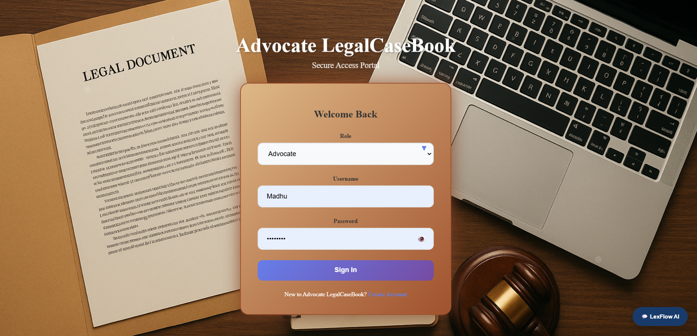
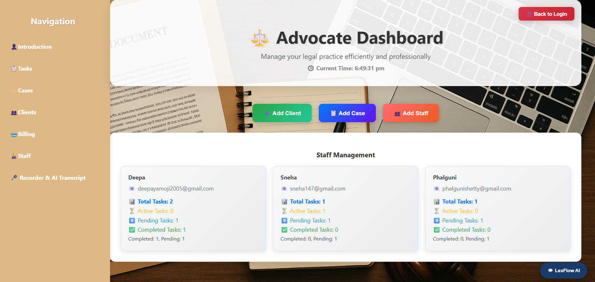
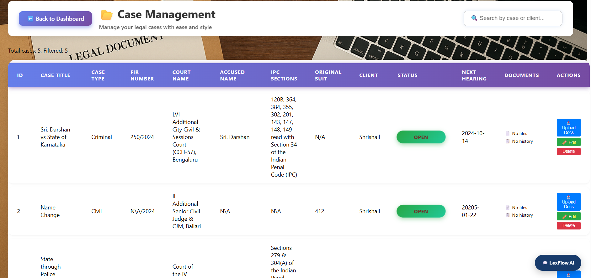
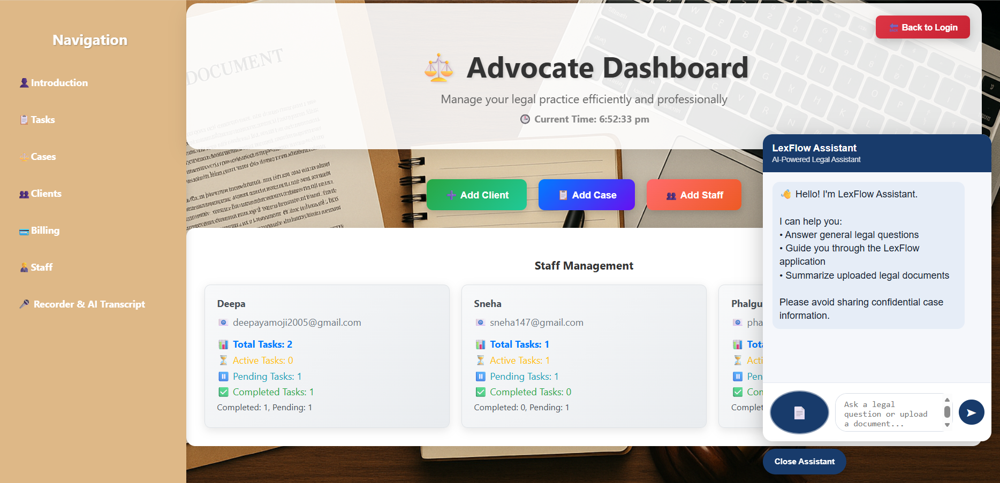
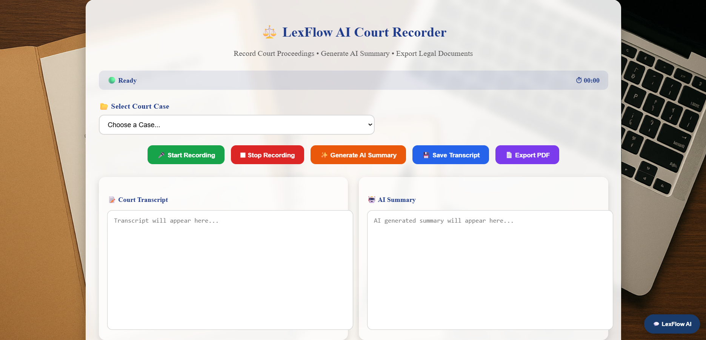

# ⚖️ LexFlow – AI Powered Legal Case Management System

## 📌 Project Overview
LexFlow is an AI-powered legal case management system designed to simplify and organize legal workflows. It helps advocates, clients, and staff manage legal cases, documents, deadlines, and communication efficiently.

The system integrates an AI chatbot and speech recognition to make information access and documentation easier.

## ✨ Key Features
- Advocate, Client, and Staff Management
- Case Management and Tracking
- Document Upload and Management
- AI-powered Chatbot
- Speech Recognition
- AI-based Document Summarization
- Court Recorder and Transcript Management
- Billing and Invoice Management
- Task and Deadline Tracking
- Dashboard for managing legal activities

## 🛠️ Technologies Used

**Frontend**
- React.js
- HTML
- CSS
- JavaScript

**Backend**
- Node.js
- Express.js

**Database**
- MySQL

**AI Technologies**
- Ollama
- Speech Recognition API

## 📂 Project Structure

- frontend/ – React frontend application
- backend/ – Node.js and Express backend

## ⚙️ Installation and Setup

### 1. Clone the Repository

git clone https://github.com/hhmadhu0-cmyk/LexFlow
cd LexFlow

### 2. Backend Setup

cd backend
npm install

Configure your environment variables and database connection using your local MySQL setup.

Start the backend:

node Server.js

### 3. Frontend Setup

Open another terminal:

cd frontend
npm install
npm start

Use the frontend URL displayed in your terminal to access the application.

## 🎯 Objective
To provide an efficient, organized, and user-friendly platform for legal case management by combining web technologies, AI capabilities, and speech recognition.

## 👩‍💻 Developed As
Academic Project – Computer Science and Engineering

## 📸 Project Screenshots

### Login Page

### Advocate Dashboard

### Case Management

### AI Chatbot

### AI Court Recorder

